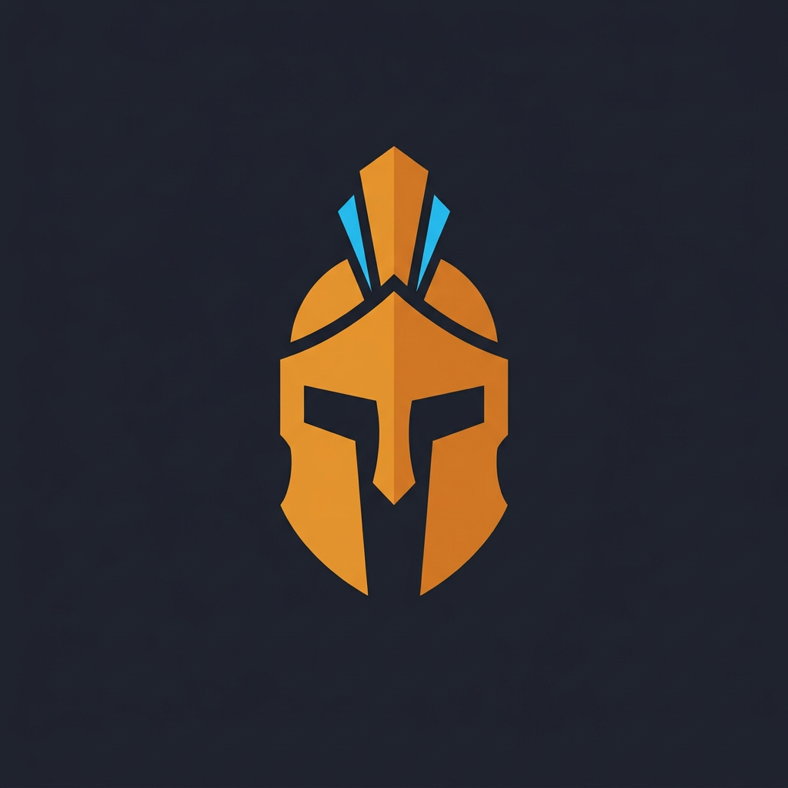

<div align="center">
  
  <h1>Talos Engine</h1>
  <p><strong>Lightweight, self-contained 2D game engine and visual editor written in C++17.</strong></p>
</div>

---

## Overview

**Talos Engine** is a fast, minimal 2D game engine and integrated visual editor designed around simplicity and direct workflows. Instead of deep object inheritance hierarchies or nested inspector menus, Talos uses flat entity composition, a first-level inspector, and human-readable `.talos` scene files.

## Key Features

- **Visual 2D Editor:** Docked workspace with Hierarchy, Interactive 2D Viewport (pan, zoom-to-cursor, grid, gizmos), First-Level Inspector, and real-time Debug Console.
- **Zero-Inheritance Entities:** Flat entity composition (`Transform`, `Sprite`, `Text`, `Collider`, `Movement`, `Camera`) editable in at most two clicks.
- **2D Rendering & Animation:** PNG texture caching, explicit depth sorting (`sortingLayer` & `zOrder`), UV sprite-sheet slicing, sprite flipping (`flipX` / `flipY`), and built-in frame-by-frame sprite animation.
- **Runtime 2D Camera:** Configurable Play Mode camera supporting fixed views, smooth damped target tracking, zoom, and an Edit Mode frustum gizmo.
- **Live Play Mode & Undo/Redo:** Instant in-editor simulation (`Play` / `Stop`) with automatic world-state restoration and full snapshot Undo/Redo (`Ctrl+Z` / `Ctrl+Y`).
- **Configurable Input Map:** Logical input actions (`InputMap`) with multi-key bindings persisted to disk.
- **Git-Friendly `.talos` Scenes:** Deterministic, human-readable flat text serialization built for clean diffs.

## Getting Started

### Prerequisites
- **C++17** compatible compiler (MSVC, GCC, or Clang)
- **CMake 3.16+**

### Build & Run

```bash
# Configure and build
cmake -B build
cmake --build build

# Run the Editor (from the project root)
./build/TalosEngine
```

## Editor Shortcuts

| Shortcut | Action |
| :--- | :--- |
| **Middle / Right Click Drag** or **`Space` + Left Drag** | Pan Viewport Camera |
| **Mouse Wheel** | Zoom Viewport Camera to Cursor |
| **`F`** | Focus Selected Entity |
| **`Ctrl + S`** | Save Active Scene (`.talos`) |
| **`Ctrl + Z` / `Ctrl + Y`** | Undo / Redo |
| **`F3`** | Toggle Real-Time Diagnostic Overlay |

## Documentation

For detailed technical guides on each subsystem, see the [`docs/`](docs/) directory.
