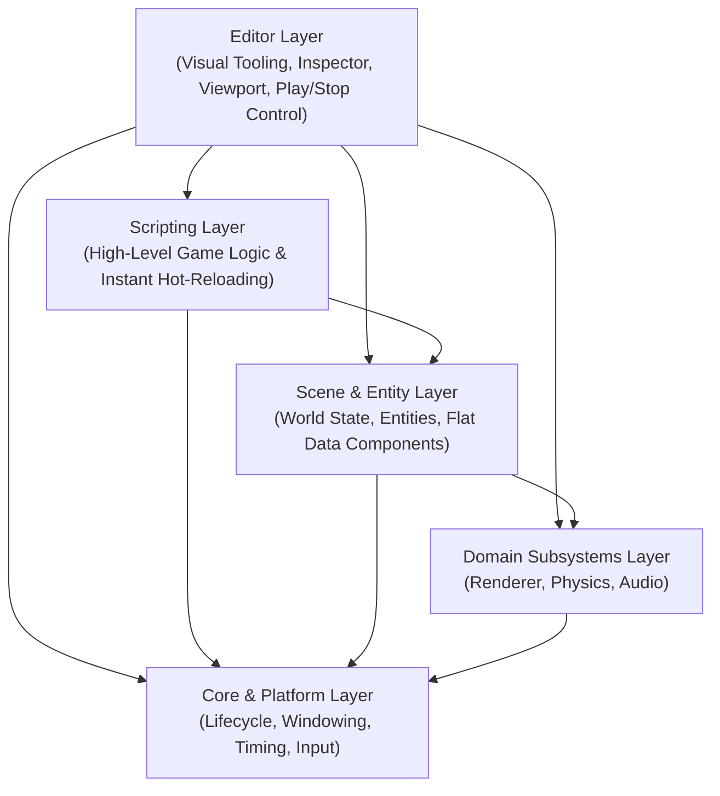

# Talos Engine — Architecture Overview

Talos Engine is designed around a **strict layered architecture** and **data-oriented composition**. The primary goals of the architecture are high runtime performance, zero-Wait iteration times, strict module isolation, and avoidance of deep object-oriented inheritance hierarchies.

---

## 1. Core Architectural Principles

### Strict Layering & Unidirectional Dependencies
The engine is divided into distinct horizontal layers. Each layer has a single, well-defined responsibility and exposes a minimal public contract.
* **Top-Down Dependency Rule:** Higher-level layers may depend on lower-level layers, but lower-level layers must **never** know about or depend on higher-level layers.
* **Single Point of Access:** Every subsystem (Windowing, Input, Rendering, Physics, Scene Management, Scripting) is accessed exclusively through its dedicated module interface. No subsystem is allowed to bypass a layer boundary.

### Complete Backend Encapsulation
Third-party libraries (such as graphics APIs, OS windowing backends, or audio libraries) are strictly isolated inside the internal implementation of their respective layers.
* Public headers only expose Talos Engine types.
* External backend headers never leak into the rest of the engine.
* Replacing or upgrading an underlying backend (e.g., adding a new rendering API or 3D pipeline in the future) requires changes only within that specific subsystem's internal implementation.

### Composition Over Inheritance (Zero-Inheritance Entities)
To avoid the fragility and tight coupling of deep C++ class hierarchies, game objects in Talos Engine do not use polymorphic inheritance trees.
* **Entities** are lightweight unique identifiers.
* **Components** are plain, flat data structures representing specific capabilities (Transform, Visual/Sprite, Text, Collider, Script).
* **Systems** operate on contiguous data sets during the frame lifecycle, ensuring predictable execution order and cache-friendly performance.

---

## 2. Architectural Layers



### Layer 1: Core & Platform Layer
The lowest layer of the engine. It abstracts the host operating system and hardware state.
* **Application Lifecycle:** Manages initialization, the main execution loop, frame synchronization, and graceful shutdown.
* **Window & Timing:** Controls display surface creation, frame rate targets, and frame delta time (`delta`) calculation.
* **Input System:** Polls and normalizes keyboard, mouse, and controller state into engine-native queries.

### Layer 2: Domain Subsystems Layer (Rendering, Physics, Audio)
Independent engines responsible for processing specific domains without knowing about game rules or editor tools.
* **Renderer:** The **only** module permitted to issue draw calls. Accepts engine-native primitives, textures, typography, and camera data, and translates them into GPU commands. Designed for 2D first while maintaining a clean boundary for 3D expansion.
* **Physics & Collisions:** Evaluates spatial overlaps, resolves movement constraints, and reports collision events using pure mathematical primitives.
* **Audio:** Handles sound playback and mixing independently of the rendering and scene loops.

### Layer 3: Scene & Entity Layer
Manages the active world state and the objects within it.
* **Flat Entity Model:** Instead of requiring deeply nested trees of auxiliary nodes for basic behavior, an entity directly aggregates the data components it needs.
* **Stable Identification:** Entities are referenced by persistent identifiers or tags rather than fragile hierarchy paths, ensuring that reorganizing a scene never breaks references.
* **Deterministic Update Pipeline:** Coordinates how entities are updated and submitted to the Physics and Renderer layers each frame.

### Layer 4: Scripting Layer
Bridges the compiled C++ engine core with high-level game logic (Python).
* **Zero Compilation Wait:** Scripts are interpreted and bound directly to the Scene and Core APIs without requiring project recompilation or domain reloads.
* **Live Hot-Reloading:** Modifications to script logic take effect immediately, preserving rapid creative iteration.

### Layer 5: Editor Layer
Sits at the very top of the architecture as a consumer of the engine layers below it.
* **Strict Separation from Runtime:** The core engine and scene layers have no awareness of the Editor. A standalone game build simply excludes the Editor layer without altering any underlying code.
* **First-Level Ergonomics:** The Editor inspects and mutates entity data directly, exposing essential properties (position, size, color, text, collision, script) at the top level rather than burying them inside nested sub-inspectors.

---

## 3. Frame Execution Flow (The Engine Loop)

Every frame executes a deterministic, strictly ordered pipeline across layers:

1. **Platform Poll (Core Layer):** Poll OS events, update the delta timer, and capture a snapshot of all input devices.
2. **Logic & Scripting Update (Scripting & Scene Layers):** Execute active scripts and update entity states using the current `delta` time.
3. **Physics Resolution (Physics Layer):** Step spatial movement and resolve collisions across active collider components.
4. **Render Submission (Renderer & Editor Layers):** Begin the frame, submit visible scene components to the Renderer, overlay Editor tooling (when running in Editor mode), and present the frame to the display.

---

## 4. Modular Tree Structure (Central Orchestrator + Branches)

Within each architectural layer, subsystems follow a **Godot-style modular tree organization** (`Central Orchestrator -> Specialized Branches`) to prevent monolithic files:

```text
talos-engine/
├── engine/                       # Engine library (no editor dependency); include root: "core/...", "scene/..."
│   ├── core/                         # Layer 1: Core & Platform
│   │   ├── window.h / .cpp           # OS window lifecycle & frame timing
│   │   ├── input.h / .cpp            # Hardware keyboard & mouse polling
│   │   ├── input_map.h / .cpp        # Logical actions & .talos InputMap persistence
│   │   └── logger.h / .cpp           # Classified debug logger ([INFO], [WARN], [ERROR])
│   ├── renderer/                     # Layer 2: Rendering Subsystem
│   │   └── renderer2d.h / .cpp       # Exclusive 2D draw call submission & GPU texture cache
│   ├── physics/                      # Layer 2: Physics Subsystem
│   │   └── physics2d.h / .cpp        # 2D AABB overlap & movement resolution
│   ├── scene/                        # Layer 3: Scene & Entity Layer
│   │   ├── entity.h                  # Flat zero-inheritance Entity & Component structs
│   │   ├── scene.h / .cpp            # World state & per-component telemetry counters
│   │   └── scene_serializer.h / .cpp # Human-readable .talos scene persistence
└── editor/                       # Layer 5: Visual Editor (EditorNode + Branches)
    ├── main.cpp                  # Engine bootstrap & main loop
    ├── editor.h / .cpp           # Central Editor Orchestrator (EditorNode)
    ├── gui/                      # Branch: Immediate-mode UI widgets & text controller
    │   └── editor_gui.h / .cpp
    ├── history/                  # Branch: Universal Undo/Redo & drag snapshot manager
    │   └── editor_undo_redo.h / .cpp
    ├── toolbar/                  # Branch: Top command bar & status notification banner
    │   └── editor_toolbar.h / .cpp
    ├── viewport/                 # Branch: 2D Canvas Viewport & [F3] Diagnostic Overlay
    │   ├── canvas_viewport.h / .cpp
    │   └── diagnostic_overlay.h / .cpp
    ├── docks/                    # Branch: Docked Editor Panels
    │   ├── scene_tree_dock.h / .cpp
    │   ├── inspector_dock.h / .cpp
    │   └── console_dock.h / .cpp
    └── dialogs/                  # Branch: Project Modal Windows
        └── input_map_dialog.h / .cpp
```

