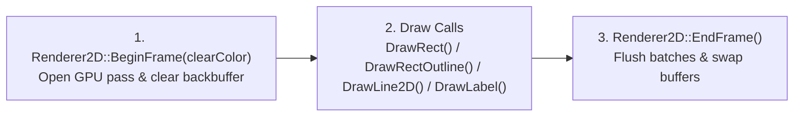

# 2D Rendering Subsystem (`Renderer2D`)

The **2D Rendering Subsystem** sits in the Domain Subsystems Layer (Layer 2) and serves as the **single authorized gateway** for issuing drawing commands to the GPU.

---

## 1. Architectural Role & Backend Encapsulation

In many engines, rendering calls are scattered across gameplay scripts, UI widgets, and entity classes. This creates severe maintenance issues whenever the graphics pipeline is updated or extended (for example, when adding batching, custom shaders, viewport framebuffers, or 3D rendering).

Talos Engine enforces a strict boundary:
* **Exclusive Draw Authority:** Only `Renderer2D` is permitted to invoke low-level graphics backend functions.
* **Engine-Native Data Types:** Upper layers communicate with the renderer using engine-owned types such as `ColorRGBA` (an 8-bit per channel RGBA structure) and floating-point coordinates.

---

## 2. TrueType Typography & Native-Size Atlas Caching

Many lightweight graphics libraries default to an embedded retro/arcade pixel font, which is difficult to read in a modern editor interface and scales poorly when resized.

`Renderer2D` replaces the default bitmap font with a **TrueType (`.ttf`) Native-Size Typography Cache**:

1. **Clean Sans-Serif Font Resolution (`ResolveCleanFontPath`):**
   During `Renderer2D::Init()`, the renderer automatically locates a modern sans-serif TrueType font (such as **Segoe UI** on Windows or a bundled engine font) without requiring manual user setup.
2. **On-Demand Native-Resolution Rasterization (`GetFontForSize`):**
   If a TrueType font is loaded at a single fixed size (e.g., `20px`) and stretched to `48px`, it becomes blurry. Instead, `Renderer2D` maintains an internal hash map (`std::unordered_map<int, Font>`) indexed by exact pixel height:
   * Whenever `DrawLabel` or `MeasureTextWidth` requests a `fontSize`, the renderer checks if a GPU texture atlas already exists for that exact pixel size.
   * If not, it rasterizes the `.ttf` file at that exact 1:1 pixel height with bilinear anti-aliasing (`TEXTURE_FILTER_BILINEAR`) and caches it in VRAM for all future frames.
3. **Deterministic Cleanup (`Renderer2D::Shutdown`):**
   When the engine closes, `Shutdown()` iterates through the font cache and releases all GPU texture atlases before the OpenGL context is destroyed.

---

## 3. Frame Rendering Lifecycle

Every rendered frame follows a strict three-stage contract:

1. **Begin Frame (`Renderer2D::BeginFrame`):**
   Prepares the GPU backbuffer for drawing and clears the previous frame's pixels to a solid background color.
2. **Primitive & Typography Submission (`DrawRect`, `DrawRectOutline`, `DrawLine2D`, `DrawLabel`):**
   Upper layers (such as `Scene::Render` or `Editor`) submit 2D rectangles, outlines, grid lines, and anti-aliased TrueType text in deterministic order (back-to-front).
3. **End Frame (`Renderer2D::EndFrame`):**
   Flushes all queued draw commands to the GPU and swaps the hidden backbuffer with the visible frontbuffer (Double Buffering), ensuring tear-free presentation on the monitor.
