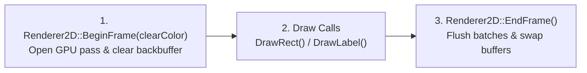

# 2D Rendering Subsystem (`Renderer2D`)

The **2D Rendering Subsystem** sits in the Domain Subsystems Layer (Layer 2) and serves as the **single authorized gateway** for issuing drawing commands to the GPU.

---

## 1. Architectural Role & Backend Encapsulation

In many engines, rendering calls are scattered across gameplay scripts, UI widgets, and entity classes. This creates severe maintenance issues whenever the graphics pipeline is updated or extended (for example, when adding batching, custom shaders, viewport framebuffers, or 3D rendering).

Talos Engine enforces a strict boundary:
* **Exclusive Draw Authority:** Only `Renderer2D` is permitted to invoke low-level graphics backend functions.
* **Engine-Native Data Types:** Upper layers communicate with the renderer using engine-owned types such as `ColorRGBA` (an 8-bit per channel RGBA structure) and floating-point coordinates.

---

## 2. Frame Rendering Lifecycle

Every rendered frame follows a strict three-stage contract:

1. **Begin Frame (`Renderer2D::BeginFrame`):**
   Prepares the GPU backbuffer for drawing and clears the previous frame's pixels to a solid background color. Without clearing the color buffer, moving objects would leave trails ("hall-of-mirrors" ghosting) across the screen.
2. **Primitive & Typography Submission (`DrawRect`, `DrawLabel`):**
   Upper layers (such as `Scene::Render` or `Editor`) submit 2D rectangles, sprites, and text labels in deterministic order (back-to-front). Floating-point world coordinates are converted internally into pixel-aligned screen positions.
3. **End Frame (`Renderer2D::EndFrame`):**
   Flushes all queued draw commands to the GPU and swaps the hidden backbuffer with the visible frontbuffer (Double Buffering), ensuring tear-free presentation on the monitor.

